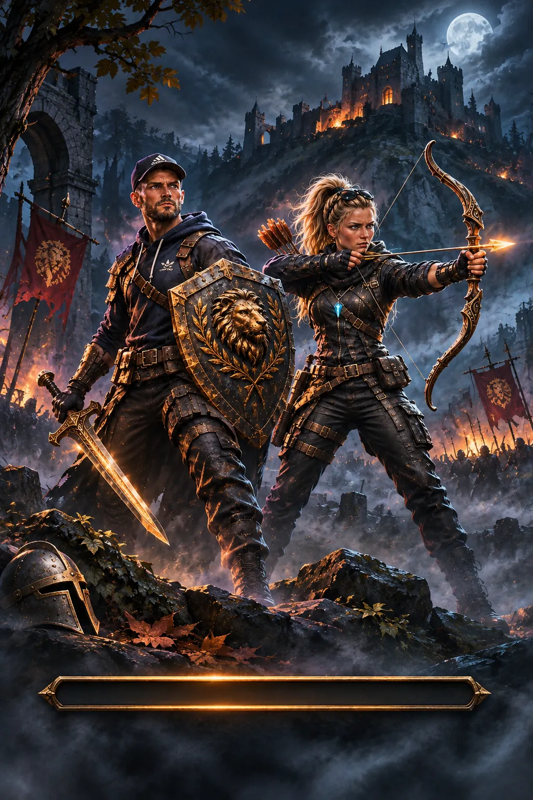

# Denkmal TD2

[](https://github.com/imbaaalanced-dot/a/actions/workflows/test.yml)
[](LICENSE)

**Denkmal TD2** ist ein Open-Source-Tower-Defense-Spiel im historischen Denkmal-Setting – kostenlos im Browser spielbar, mit Fokus auf mobile Hochformat-Displays und Style-2-Grafik.

### ▶ [Jetzt im Browser spielen](https://imbaaalanced-dot.github.io/a/)



> Das Bild zeigt die Titelgrafik. Ein echter Gameplay-Screenshot unter `docs/screenshot.png` steht noch aus.

## Features

- Tower Defense mit Türmen, Helden, Gegnerwellen und Kampagnenlevels
- Denkmal-Schauplätze wie Kirchende, Hohensyburg und Westhofen (je nach Build/Spielstand)
- Ansturm-Spielmodus und persistente Beute-/Ausrüstungssysteme
- JavaScript, HTML und CSS – ohne Installation im Browser spielbar
- Android-/Touch-Optimierung in Arbeit (4-GB-Gerät als wichtiges Prüfziel)

**Status:** fortlaufende Alpha-Entwicklung. Ein veröffentlichter Build ist nicht automatisch auf einem echten Android-Gerät abgenommen.

## Schnellstart

```bash
git clone https://github.com/imbaaalanced-dot/a.git
cd a
python3 -m http.server 8777 --directory dist
```

Danach `http://localhost:8777/` aufrufen. Die App ist statisch; am Repository-Root gibt es derzeit kein `npm run dev`.

Kurze Testauswahl (Node.js 22 und Python 3):

```bash
node tests/game.test.cjs
TEST_MOBILE=1 node tests/game.test.cjs
npm test --prefix ansturm-alpha1-5
python3 tests/assets.test.py
```

Die CI-Konfiguration steht in [test.yml](.github/workflows/test.yml). Der reguläre Browser-Build wird aus `dist/` veröffentlicht.

## Entwicklung und Feedback

**Denkmal TD2 wird von imbaaalanced-dot allein entwickelt.** Externe Pull Requests, Code- oder Grafikbeiträge werden derzeit nicht angenommen. Der Quellcode ist öffentlich zugänglich; Fehlermeldungen, sachliches Feedback und Ideen bleiben willkommen.

- [Fehler melden oder eine Idee vorschlagen](https://github.com/imbaaalanced-dot/a/issues/new/choose)
- [Fragen und Diskussionen](https://github.com/imbaaalanced-dot/a/discussions)
- [Hinweise für gute Fehlermeldungen](CONTRIBUTING.md)
- [Roadmap](ROADMAP.md)
- [Verhaltenskodex](CODE_OF_CONDUCT.md) und [Sicherheitsmeldungen](SECURITY.md)

## Lizenz und Bildrechte

Der selbst erstellte Projektcode wird unter der [MIT-Lizenz](LICENSE) bereitgestellt. Bei Fotos, Referenzmaterial und Assets mit fremden Rechten müssen Herkunft und jeweilige Nutzungsrechte vor einer Weiterverwendung gesondert geprüft werden.

## Entwicklungshistorie

Die frühere ausführliche README ist als [Entwicklungsarchiv](docs/README_HISTORY_2026.md) erhalten. Versionen und Testbelege in älteren Dokumenten können historisch sein.
