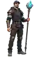

# TD2 Beta · Marcel-Kristallstab · Art-Freigabevorlage (17.11.2026)

**Status:** `art_approval=manual-required` · **NOT APPROVED** · **NO RUNTIME CHANGE**  
**Betreff:** Issue #330, P0 „Marcel-Referenz“, nach dem technisch erfolgreichen Porträtwechsel in PR #347.

## Ist-Befund und geplanter Sollzustand

Die aktive kanonische Porträtquelle auf `main` ist `dist/assets/menu/v5-avatars/marcel-guardian-v6.webp`. Sie zeigt **Schwert und Schild** und ist damit noch keine akzeptierte Marcel-Identität. `kim-marksman-v6.webp` zeigt Kim mit Bogen und bleibt unverändert. Marcels Animationen sind ebenfalls **nicht** allein durch einen Porträtwechsel erledigt.

Die verbindliche Zauberstab-Richtung stammt aus `originals/marcel-der-beschuetzer-reference-20261115.png`: dunkler Wacht-Charakter, Kristallstab mit blauer Spitze, keine Schwert-/Schild-Ausrüstung. Diese Originalreferenz selbst weist grüne Freistellungsreste auf und ist ebenfalls kein freigegebenes Runtime-Porträt.

## Neuer, nicht integrierter Bildkandidat

Ein Kandidat ist separat in der zugehörigen ChatGPT-Arbeitssitzung erstellt und als ZIP mit **1024×1536 PNG**, **640×960 WebP** und **64/128/256-px-Vergleich auf dunklem und hellem Grund** ausgeliefert. Die vorliegende **64×96-Vorschau** ist bewusst ein verkleinertes **Review-Thumbnail**, **kein Runtime-Bild**.

| Datei (nicht im Repo außer Thumbnail) | SHA-256 | Status |
| --- | --- | --- |
| `marcel-staff-v6-candidate-master.png` (1024×1536) | `40c8a04f19fb61660797314eba9b18e66d4e3882261ad2f7528b98964d68dc75` | Lokales Original, unfreigegeben |
| `marcel-staff-v6-candidate.webp` (640×960) | `0c3fae872a9ee5b9f7d392f072cb61293dd16c54a2d79f4a296be3e133fe845a` | Export-Kandidat, nicht eingebaut |
| `qa-64-128-256-dark-light.png` | `931f8dca818ef877a4b2d2a34b5b8c2a946fe82aa9333c20419fbbdd81c61106` | Größen-/Kontrastvergleich |
| `marcel-staff-v6-preview-64.webp` (64×96) | `c64f6122fd25041583675ef4fd2a1a26ac4b04478aa50b18b94692ebda5a595b` | Nur kleines GitHub-Reviewbild |

Die lokal erzeugten Masterdateien werden **nicht** allein durch diese Markdown-Dokumentation ins Repository kopiert. Die Bildgröße, Alpha-Fähigkeit und SHA des Review-Thumbnails werden durch `tools/verify-beta-marcel-art-review.cjs` automatisch abgesichert. Keine automatisierte Prüfung kann Waffenidentität, Referenztreue oder Look ersetzen.

## Verbindliche Abnahme vor jedem Runtime-Swap

- [ ] Marcel wählt die final gewünschte Form von Gesicht, Kappe, Rüstung, Pose und blauem Zauberstab. Keine Schwert-, Schild- oder Laternenreste.
- [ ] Freistellung: echte Alpha-Kanten, keine grüne, rote oder magentafarbene Fransen; keine aufgemalte Hintergrundfläche.
- [ ] Gegenprobe: dunkler und heller Style-2-Menühintergrund sowie 64/128/256-Pixel-Größen; Smartphone-Lesbarkeit.
- [ ] Vollauflösende Quelle und optimiertes WebP in **eigenen** Grafik-Commit aufnehmen; aktuelle Assets erhalten, ohne stille Umverdrahtung der Gameplay-Atlanten.
- [ ] Erst im separaten Integrations-PR Menü, HUD, Inventar und Figurenwahl umschalten; Desktop-/Touch-Chromium- und HTTP-/Decode-/Canvas-Screenshots zeigen.
- [ ] Lauf-/Angriffsrichtungen, Pivot/Atlasränder und spätere Hit-/Death-Pfade gesondert abnehmen; 18 vorhandene Down-Frames sind noch keine vollständige Richtungsserie.
- [ ] Android 4 GB / WebView auf echtem Gerät testen: Start, Auswahl Kim/Marcel, Inventar, Level, FPS/RAM, Reload und Farbsäume dokumentieren.
- [ ] Erst nach allen Freigaben `art_approval=approved` setzen und einen Merge/Release erwägen.

**Release-Grenze:** Diese PR enthält **nur** Reviewunterlagen und einen technischen Thumbnail-Check. Sie tauscht **keine aktive Spieldatei** aus, löscht keine Assets, ändert keine Save-Daten und erstellt keinen Beta-Tag.
