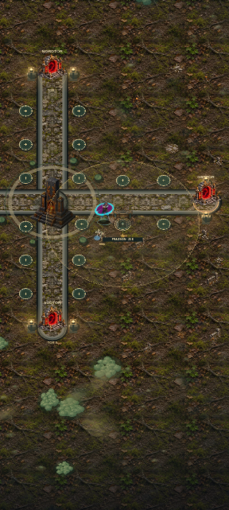
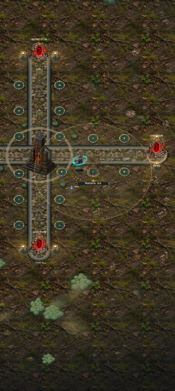
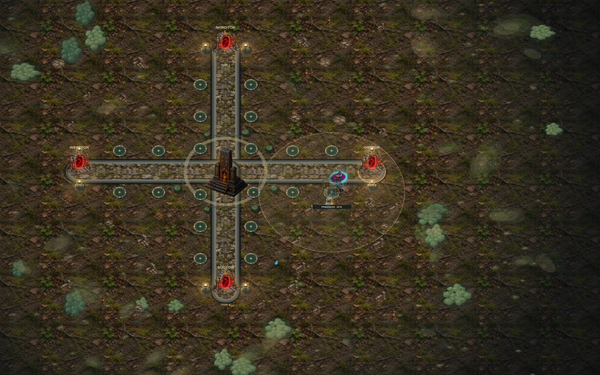
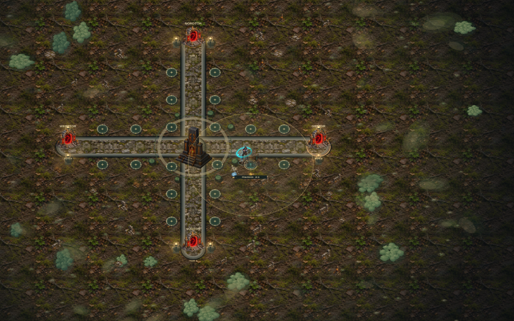

# Level 1: violette Fläche während der Bewegung

Basis: aktueller `main` `25688f44f1ae4ed4ccf9a69cf637a5078e524238`.
Nutzerpräzisierung: **Level 1 beim Laufen**. Fortsetzung der ersten Zuordnung aus Draft #322; jener PR bleibt unverändert.

## Ursache und Reproduktion

Marcels Laufatlas hat in allen zwölf Frames 0 Pixel nach dem unten genannten Violett-Schwellwert. Während der Bewegung kann der automatische Angriff aber die Laufgrafik ersetzen. Dabei zeigt `HeroSaga.draw` bei `hero.moving=true` über `TD2DirectionalActions.hero` den Angriff nach unten, Frame **4 nullbasiert**: Atlasrechteck **512,256,128,128**. Dieser aktive Frame enthält 815 sichtbare violette Matte-Pixel innerhalb des cyanfarbenen Rings. Die Fläche gehört zum Bildinhalt; ein falsches Quellrechteck ist für diesen Befund nicht erforderlich.

Nachvollziehbarer Ablauf: Level 1 starten, mit Marcel nach rechts laufen und gleichzeitig einen Gegner unterhalb des Helden automatisch angreifen lassen. Beim Ausschwingen des Angriffs erscheint die violette Fläche kurz um die Figur. Der Chromium-Test setzt Welle 14/15/16 kontrolliert, positioniert einen ausdauernden Runner unterhalb des bewegten Helden und zeichnet die tatsächlichen `drawImage`-Aufrufe auf. Der Angriff wird in diesen Bewegungstests durch die normale Simulation ausgelöst, nicht durch einen direkten `onAttack`-Aufruf.

Desktop: echte Taste D; Touch-Emulation: CDP-Touchstart/-move/-end am sichtbaren Joystick. In allen **6 Bewegungsszenarien** wurde sowohl die Laufgrafik als auch der verdächtige Angriffsframe bei `moving=true` beobachtet. Bewegung und Kamera laufen dabei normal weiter. Dies ist ein kontrollierter Regressionstest, kein natürlich bis Welle 16 gespielter Durchlauf und kein Android-Gerätetest.

## Korrektur

Gezielte Bildbearbeitung des einen aktiven Frames mit `image_gen.imagegen`: violette Füllfläche entfernen, cyanfarbenen Ring und Figur erhalten. Der generierte RGBA-Master bleibt unter `source-art/hero/repairs/20261116/` erhalten; Export und SHA-256-Herkunft sind dort dokumentiert. Keine Einbindung der neueren, noch nicht freigegebenen Zauberstab-Kandidaten unter `source-art/hero/actions-v5/marcel/down/`.

`tools/export-marcel-down-alpha-repair.py` normalisiert den korrigierten Frame auf 128×128 und packt ihn in einen **neuen** 768×768-WebP-Atlas. Die anderen **35 Zellen bleiben pixelgleich**, Originalatlas und Quellkunst bleiben unverändert. Register und Script-Cache-Key verweisen auf die Variante. Raster, Zeilen, Pivot und Animationslogik bleiben gleich. Der bearbeitete Frame wird neu gerastert; er ist kein pixelidentischer Alpha-Eingriff innerhalb dieser einen Zelle. Sichtprüfung erfolgte in 128 px und im Chromium-Spielcanvas.

## Vorher / Nachher

| Kontrollierte Szene | Vorher | Nachher |
| --- | --- | --- |
| Touch-Joystick, Level 1, Wellenstand 16, Auto/Low |  |  |
| Desktop D, Level 1, Wellenstand 14, High |  |  |

Die Bewegungsscreenshots sind direkt aus dem vollständigen Spielcanvas, ohne nachträgliche Bildbearbeitung. HUD-Elemente außerhalb des Canvas sind dort nicht enthalten. Vollständige Draw-Protokolle und Grafik-/Objektzustände stehen in `before/results.json` und `after/results.json`.

Zusätzlich zwölf isolierte Renderfälle: Desktop/Touch × High/Low × Welle 14/15/16, echte `HeroSaga.draw`-Ausführung. Vorher 421–432 violette Pixel bei Spielgröße; nachher **0 in allen zwölf Fällen**. Farbkriterium: R>100, B>100, G<100, A>100 und min(R,B)>1,4×G. Das ist ein gezielter Test dieses Defekts, kein globaler Filter für violette Magie. Keine FPS-Aussage aus diesen Screenshots.

## Prüfungen und Grenzen

- Neuer Test `python3 tests/marcel-down-violet-matte.test.py`: vor dem Fix erwarteter Fehler mit 815 Pixeln, nach dem Fix bestanden; cyanfarbener Ring und unveränderte Nachbarzellen geprüft. In regulären CI-Workflow aufgenommen.
- Chromium **156.0.8078.79**, SwiftShader, Desktop 1280×800 und Touch 412×915; Reduced Motion aus. Alle 18 Fälle bestanden, keine JavaScript-Ausnahmen. Vorher-/Nachher-Szenen haben einen kontrollierten Runner mit hohen HP und keinen Turm; kein vollständiger Kampfstressfall.
- Wiederholung nach Fix: `TD2_SPRITE_REPRO_OUT=/tmp/td2-sprite-repro-after node tools/reproduce-marcel-violet-browser.cjs`. Vorher-Modus: `TD2_SPRITE_EXPECT=violet` mit ursprünglichem Registry/Atlas.
- Tests aus `.github/workflows/test.yml`: Ergebnisse in `local-ci-tests.json`; lokale Ausführung ist kein GitHub-CI-Nachweis.
- Heldenleben/Heilung unverändert. Physisches Android mit 4 GB RAM offen.

Nächster Arbeitsschritt: FPS-Baseline in Level 1, Welle 14–16; Bewegung, Kamerabewegung und Kampfeffekte getrennt messen. Bauhinweise, Vermächtnis und HUD folgen danach. Kein Merge oder Release erfolgt.
