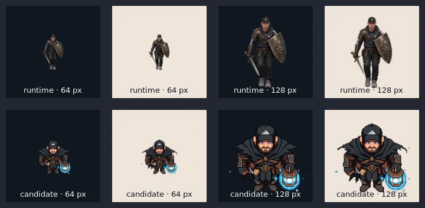

# TD2 V5 · Style-2-Kandidatenprüfung (10.11.2026)

**Basis:** `main` @ `53a81237fc5a04bed9633ebe1f3c7fcbd7da5f55` (erneut mit `git ls-remote` geprüft).

**Branch:** `audit/style2-v5-candidate-gate-20261110`

**Ergebnis:** **0 von 7 Kandidaten für die Runtime freigegeben**. Kein Runtime-Asset ersetzt, keine Animation aktiviert, keine Save-/Gameplay-/Level-Datei verändert.

## Tatsächlich verfügbare Quellen

Die sieben Dateien stammen aus den im Projektkontext bereitgestellten Anhängen. Die im [Westhofen-Audit](2026-11-10-westhofen-asset-audit.md) erwähnten sieben separaten Westhofen-Bildgruppen waren hier **nicht** als Einzeldateien verfügbar; daraus wird keine Abnahme abgeleitet. Die angehängten Quellen werden weder in `dist/assets/` aufgenommen noch in diesem Branch kopiert. Die folgenden Werte stammen aus tatsächlich dekodierten Dateien (Pillow 13.0).

| Quelldatei (Anhangsnummer) | Dekodierter Inhalt / Maße | Befund | Runtime-Entscheidung |
|---|---|---|---|
| `04-marcel_true_topdown.png` | PNG RGBA, 2240×1120, 9,57 MiB dekodiert | Vier Draufsichten statt 3×4-Laufatlas; 1.528.895 vollständig transparente Pixel mit versteckten RGB-Werten; 707 sichtbare grüne Pixel; optisch nicht die freigegebene V5b-Identität | **Sperren** |
| `05-marcel_topdown_transparent.png` | PNG RGBA, 1600×1600, 9,77 MiB dekodiert | Einzelpose ohne Aktions-/Richtungsatlas, 1.431.026 versteckte RGB-Matte-Pixel; von Heldenreferenz abweichende Ausstattung | **Sperren** |
| `06-…n.webp` | **JPEG-Inhalt trotz `.webp`**, 1280×1904, 9,30 MiB dekodiert | Vollflächiges Marcel-Porträt mit eingebauter Umgebung; kein Alphakanal, kein Sprite | **Sperren** |
| `07-…n.webp` | **JPEG-Inhalt trotz `.webp`**, 1600×1600, 9,77 MiB dekodiert | Vier Logo-Entwürfe auf einer dunklen Platte; keine freigestellten, einzeln adressierbaren UI-Elemente | **Sperren** |
| `08-…n.webp` | **JPEG-Inhalt trotz `.webp`**, 2048×1152, 9,00 MiB dekodiert | Komplettes Menü-Mockup mit fest ins Bild gerenderten Buttons; keine getrennten interaktiven Bedienelemente, Querformat | **Sperren** |
| `09-…n.webp` | **JPEG-Inhalt trotz `.webp`**, 1280×1904, 9,30 MiB dekodiert | Marcel-Porträt mit eingebautem Hintergrund; nicht als transparentes Charakter-Sprite nutzbar | **Sperren** |
| `10-marcel_walk_4x3.png` | PNG RGBA, 1344×1792, **3×4 à 448 px**, 9,19 MiB dekodiert | Alle 12 Frames belegt, aber Zellen berühren mehrfach die Ränder; 57 sichtbare Außenrandpunkte, 439 sichtbare magentafarbene Pixel, 1.193.572 versteckte RGB-Matte-Pixel; erwartete Runtime **768×1024 à 256 px**; andere Heldenidentität | **Sperren** |

Die vier Bilder mit `.webp`-Dateinamen werden vom Decoder als **JPEG** identifiziert. Eine Umbenennung allein würde weder Transparenz noch eine freigegebene Animation herstellen.

## Vergleich mit dem aktuellen Runtime-Vertrag

- `dist/directional-hero-assets-v5.js` registriert Side-Actions bei Marcel **rechts** und Kim **links** (`6×6`, `128×128` pro Frame); ungemalte Richtungen behalten den V5b-Walk-Fallback. Gegenläufiges Spiegeln asymmetrischer Ausrüstung ist absichtlich unterbunden.
- `dist/hero-saga.js` verwendet `dist/assets/hero/marcel-walk-v5b.webp` und `kim-walk-v5b.webp` (`3×4`, `256×256` pro Frame). Die bestehenden Art- und Render-Tests bestätigen diesen Vertrag.
- `dist/asset-manager.js` hält entschlüsselte Bilder nach Besitzergruppe und lädt sie asynchron. Weil keine neue Quelle aktiviert wurde, waren **keine** Cache-, Decode-, Resize-, Zeichnungsreihenfolge- oder Loaderänderungen nötig.
- `dist/assets/enemies/manifest.json` und `dist/assets/barracks/atlas-manifest.json` sind bestehende eigenständige Atlanten. Die sieben Kandidaten enthalten keine passenden Gegner-, Boss-, Kasernen- oder Turmanimationen. Deren Zuordnung bleibt unverändert.

**Alpha/Pivot/Frame-Abnahme:** Die Dateien mit Alpha wurden technisch untersucht; ein Dateialphakanal allein bedeutet noch keine saubere Freistellung. Ein belastbarer Fußpunkt/Pivot für die neuen Posen ist nicht manifestiert; auch die Silhouetten der Kandidaten weichen vom freigegebenen Marcel mit Schwert und Schild ab. Eine bloße Neuskalierung der 448er-Zellen auf 256 px würde sowohl Zellbeschnitt als auch Identitätsbruch beibehalten. **Keine automatische Bereinigung oder Aktivierung.**

## Bildvergleich 64/128 px

Die Vergleichsdatei ist eine **statische CPU-Skalierung** der mittleren ersten Walk-Zelle mit realen Quellpixeln, kein Screenshot aus Chromium oder vom Android-Gerät. Die beiden unteren Reihen zeigen den gesperrten Kandidaten mit anderem Charakterdesign und Laterne. Die Vergleichsdatei ist **nur QA-Dokumentation**, nicht Teil des Asset-Manifests.

## Neue Werkzeuge und tatsächliche Prüfungen

- `tools/audit-style2-intake.py`: schreibgeschützter Einzeldatei-/Atlas-Check für Decoderformat, echte Alpha-Deckung, transparente RGB-Matte, Farbreste, Zell- und Außenränder, Sollmaße und dekodierte Texturgröße. `pixel_gate=pass` ersetzt **keine** manuelle Style-/Pivot-Abnahme.
- `tests/style2-intake-gate.test.py`: synthetische Tests für saubere Alphadaten, falsche Atlaskonfiguration, JPEG als `.webp`, fehlende Alpha und Rand-/Magenta-Probleme.
- `tools/preview-style2-intake.cjs`: vorbereiteter Vergleichs- und Gameplay-Capture für Desktop-Chromium und mobile Touch-Emulation; verlangt die separat bereitgestellten Kandidaten. Die Quelle wird nicht in die Runtime kopiert.
- `.github/workflows/td2-style2-intake-qa.yml`: separater PR-Gate für Python-Assettests, den existierenden kanonischen Rendervertrag und Chromium-Smokes. CI-Ergebnis muss am tatsächlichen PR geprüft werden.

| Testklasse | Ergebnis dieser lokalen Runde |
|---|---|
| 103 bestehende Node-Testdateien | **Bestanden** (alle `tests/*.test.cjs`) |
| 16 Python-Assettestdateien | **Bestanden** (alle `tests/*.test.py`) |
| Ansturm `npm test --prefix ansturm-alpha1-5` | **76 Tests bestanden** |
| 7 mobile-Logikdateien mit `TEST_MOBILE=1` | **Bestanden** |
| Lokaler Desktop-Chromium und Touch-Emulation | **Blockiert**, Prozessstart mit `socket(): Operation not permitted`; **kein** erfolgreicher Browser-Smoke belegt |
| Ingame-Screenshots aus diesem Branch | **Nicht erstellt**, durch Chromium-Startblocker |
| Physisches Android-Gerät (4 GB RAM) | **Offen**, keine Gerätemessung; keine FPS-/RAM-Zahlen erfunden |
| GitHub Actions / PR | **Beim Erstellen des PR prüfen**; lokal keine CI-Ausführung behauptet |

## Übergabe / kleinster nächster Schritt

1. Einen freigegebenen **Marcel-V5b-konformen** 3×4-RGBA-Laufatlas bereitstellen oder den vorhandenen V5b-Atlas behalten; 256er Zellen, mindestens 2 px freier Zellrand, konsistenter Standpunkt und saubere RGB-Matte.
2. Neue Quelle auf 64 und 128 px vor dunklem und hellem Untergrund sowie als kontrollierte Ingame-Aufnahme prüfen. Danach erst den Asset-Loader auf dem Branch anpassen.
3. Desktop-/Touch-Chromium bei GitHub Actions und später **separat** das echte Android-Gerät abnehmen.

**Merge-Sperre:** Dies ist ein reiner Prüf-/Vorbereitungsbranch. **Kein Merge, keine Veröffentlichung und keine Veränderung von Speicherständen oder Balance ohne ausdrückliche Freigabe.**
